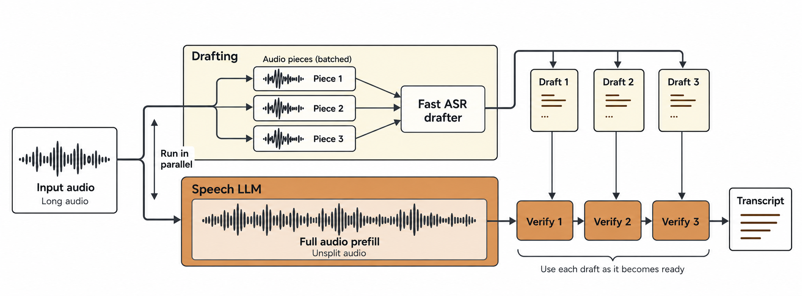

# specspeech: Speculative Decoding for fast ASR and TTS inference



## Quickstart

Python 3.12–3.14 and a at least CUDA 13-compatible NVIDIA driver:

```bash
git clone https://github.com/yaya-sy/specspeech.git
cd specspeech
uv venv --python 3.12
source .venv/bin/activate
uv pip install -e '.[soundsgood]' dist/specspeech_soundsgood-*.whl
uv pip check
```

Download `nvidia/parakeet-tdt-0.6b-v3` and export its TensorRT engine on your inference GPU:

```bash
BATCH_SIZE=8 MAX_AUDIO_SECONDS=300 bash scripts/export.sh parakeet \
  checkpoints/parakeet exported/parakeet-custom
```

### CLI inference

Pass audio files or folders; folders are searched recursively and files are loaded as needed.

```bash
specspeech asr recordings/ \
  --drafter parakeet --drafter-engine exported/parakeet-custom \
  --k 32 --lookup suffix_gpu \
  --drafter-max-audio-seconds 300 --verifier-max-audio-seconds 1200 \
  --batch-size 8 --max-pending 32 --gpu-memory-utilization 0.7 \
  --max-model-len 32768 --max-new-tokens 8192 --language English
```

See `specspeech asr --help` for all options.

### Python inference

```python
from specspeech.asr.audio import audio_segments
from specspeech.asr.speculators import SoundsGoodDrafter
from specspeech.asr.verifiers.vllm import QwenASRVerifier

drafter = SoundsGoodDrafter(
    model="parakeet",
    engine_path="exported/parakeet-custom",
    drafter_max_audio_seconds=300,
)
verifier = QwenASRVerifier(
    k=32,
    lookup="suffix_gpu",
    max_model_len=32768,
    max_num_seqs=8,
    gpu_memory_utilization=0.7,
)
samples = audio_segments(["recordings/"], verifier_max_audio_seconds=1200)
results = verifier.transcribe(
    samples, drafter, max_pending=32, max_tokens=8192, language="English",
)
try:
    for sample, result in results:
        print(sample["path"], sample["segment_index"], result["text"])
        print("Accepted draft tokens:", result["accepted"])
finally:
    results.close()
    verifier.close()
```

## Optional draft repunctuation

For CTC drafts or other drafts without punctuation and capitalization:

```bash
uv pip install -e '.[punctuator]'
hf download 1-800-BAD-CODE/punctuation_fullstop_truecase_english \
  punct_cap_seg_en.onnx spe_32k_lc_en.model config.yaml --local-dir exported/punctuator
```

Add `--punctuator exported/punctuator/punct_cap_seg_en.onnx` to the CLI command.
In Python, load it before inference and pass `punctuator=punctuator` to `verifier.transcribe`:

```python
from specspeech.asr.punctuator import load_punctuator

punctuator = load_punctuator("exported/punctuator/punct_cap_seg_en.onnx")
```

Keep the downloaded tokenizer and configuration beside the ONNX file.
Repunctuation runs in the background with drafting, alongside Qwen prefill and verification.

## Benchmark results

**72,442 clips (157.8 hours)** across seven English test
sets from Open-ASR-Leaderbord, on one **NVIDIA A40**. Both conditions use `Qwen/Qwen3-ASR-1.7B`, BF16, greedy decoding, continuous batching and CUDA graphs, with vLLM 0.30.0 and Torch 2.13.0 (CUDA 13.0).

| Dataset | Clips | Audio hours | Native vLLM RTFx ↑ | specspeech RTFx ↑ | Speedup |
|---|---:|---:|---:|---:|---:|
| AMI Cleaned | 7,805 | 8.02 | 104.55 | **187.42** | **1.79×** |
| Earnings22 Cleaned (AA chunked) | 341 | 1.92 | 214.38 | **347.59** | **1.62×** |
| GigaSpeech Cleaned | 18,768 | 35.15 | 126.74 | **280.35** | **2.21×** |
| LibriSpeech test-clean | 2,620 | 5.40 | 139.03 | **345.46** | **2.48×** |
| LibriSpeech test-other | 2,939 | 5.34 | 133.43 | **288.70** | **2.16×** |
| SPGISpeech | 39,341 | 100.00 | 163.41 | **394.69** | **2.42×** |
| VoxPopuli Cleaned (AA) | 628 | 1.98 | 182.70 | **417.78** | **2.29×** |
| **Full suite (pooled)** | **72,442** | **157.81** | **148.22** | **338.71** | **2.29×** |

Native vLLM runs the verifier alone; specspeech adds Parakeet v3 with
`lookup="suffix_gpu"` and `k=32`. Total processing time: **63.88 minutes** for
native vLLM and **27.95 minutes** for specspeech.

Settings: 8 active verifier requests, 32 pending requests, drafter batch size 8,
300-second draft pieces, 1,200-second verifier limit, 32,768-token context,
8,192-token output limit and GPU memory utilization 0.7. The baseline uses async
scheduling; the custom speculative drafter uses synchronous scheduling.
